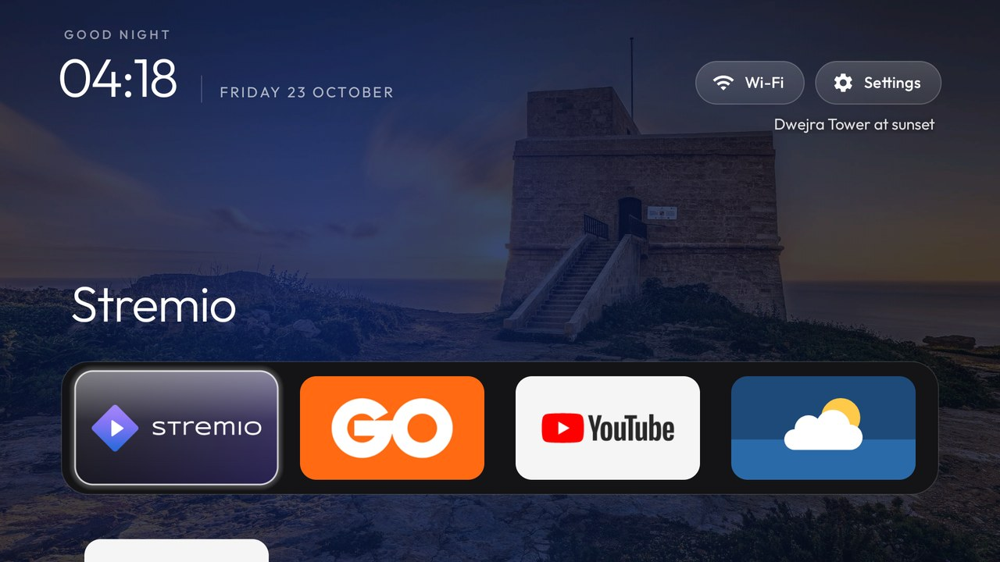

# Themes

A theme is a folder with a `config.json` and, optionally, a `wallpaper.jpg`. Pushing one changes the
launcher's dock, layout and look on the TV without rebuilding the APK: the launcher reads
`config.json` as an overlay over its built-in `config.xml` the next time it starts.
Choices made in Launcher settings take priority until you choose Follow theme. Pushing a theme or
using `tools/theme.sh --reset` also clears those on-TV column and motion choices.

```bash
TV_HOST=192.168.1.50 tools/theme.sh themes/aurora          # push a theme and restart Home
TV_HOST=192.168.1.50 tools/theme.sh --reset                # back to the built-in config.xml
powershell -ExecutionPolicy Bypass -File tools\theme.ps1 -TvHost 192.168.1.50 themes\aurora
```

| Theme | What it does | Screenshot |
|---|---|---|
| `default/` | The built-in look written out as JSON, as a starting point for your own |  |
| `aurora/` | A dark aurora wallpaper (teal and violet on navy, darker at the bottom) with a matching background colour |  |
| `family-gozo/` | Parents' home theme with Ta' Pinu as the first 1920×1080 wallpaper, and a calm 12-hour rotation to Dwejra; Stremio and GO TV lead the dock |  |
| `glass/` | Dark navy wallpaper with soft teal and violet light, the cinematic top shelf, a frosted-glass dock, icon-only buttons and the focus glow in the app's colour, gliding without overshoot |  |
| `scenes/` | 14 dark illustrated landscapes in `wallpapers/`, a new one every hour; drawn from code by `tools/scenes_wallpapers.py` |  |
| `six-columns/` | Six smaller tiles per row and one grid row visible under the dock |  |

Every theme folder has a `screenshot.jpg` of Home with that theme on a real TV. `tools/theme.sh` never
pushes it; it is only here so you can see a theme before you try it.

## Keys

Every key is optional; a missing key keeps the value from `config.xml`, an unknown or wrongly typed key
is ignored, and a file that does not parse is ignored as a whole, so a theme can never break Home.